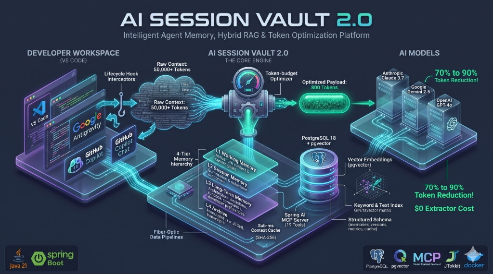

# AI Session Vault 2.0
### Intelligent Agent Memory, Hybrid RAG & Token Optimization Platform


[](https://github.com/livejpsingh/ai-session-vault/actions/workflows/ci.yml)
[](https://github.com/livejpsingh/ai-session-vault/actions/workflows/cd.yml)
[](https://openjdk.org/projects/jdk/21/)
[](https://spring.io/projects/spring-boot)
[](https://github.com/pgvector/pgvector)
[](https://modelcontextprotocol.io/)
[](LICENSE)

---



---

## 🌟 Executive Summary

**AI Session Vault 2.0** is an open-source, self-hosted conversation persistence, hierarchical memory, and token-budget optimization platform for AI coding agents. 

When developers interact with AI coding assistants (**Google Antigravity**, **GitHub Copilot**, Claude Code, Cursor) in VS Code, conversational transcripts quickly bloat to 30,000–100,000+ tokens per session. Continuously resending massive historical transcripts to LLM providers:
1. **Drives up organizational API costs** exponentially.
2. **Degrades agent response latency** due to processing bloated context windows.
3. **Dilutes LLM focus**, leading to hallucination or forgetting critical architectural decisions and technical constraints.

**AI Session Vault 2.0** acts as an intelligent intermediary memory layer that automatically captures conversations via lightweight editor hooks, extracts reusable memories with **$0 LLM cost**, and dynamically compresses context into exact requested token budgets (**70% to 90% token reduction**).

---

## ⚡ Core Platform Capabilities

### 1. 🎯 Knapsack Token Budget Optimization Engine
- **Strict Budget Packing:** Packs high-relevance memories and technical facts into exact token limits (e.g. 500, 1,000, or 2,000 tokens) using real model tokenizers (`JTokkit` for OpenAI/Claude, `WordPiece` for Gemini).
- **Zero Silent Overruns:** Guarantees returned context $\le \text{tokenBudget}$ in 100% of calls. Emits warnings if essential constraints cannot fit inside micro-budgets.
- **Optimization Modes:**
  - `QUALITY_FIRST`: Preserves verbatim code blocks, technical commands, and architectural decisions.
  - `BALANCED`: Prunes conversational pleasantries while strictly preserving technical identifiers, parameters, and constraints.
  - `AGGRESSIVE`: Distills memories into compact key-value pairs, bullet facts, and structural summaries.
- **Sub-Millisecond Context Cache:** Keyed with SHA-256 hashes to serve repeated queries in $< 30\text{ ms}$.

### 2. 🧠 $0-Cost Deterministic Memory Extraction
- Automatically parses incoming transcripts to detect and categorize facts without burning external LLM tokens on every message:
  - **`DECISION`:** Architectural choices, framework selections, database choices (e.g., *"Decided to use PostgreSQL with pgvector"*).
  - **`PROJECT`:** Tech stack, frameworks, ports, dependencies, versions.
  - **`PREFERENCE`:** Developer conventions (*"Prefer PowerShell on Windows"*, *"Use tabs"*).
  - **`PROCEDURAL`:** Verified runbook commands (`.\mvnw test`, `docker compose up -d`).
  - **`ACTION`:** Unresolved TODOs, FIXMEs, and open bugs.
- **Historical Audit Versioning:** When facts or decisions change, the previous state is archived in `memory_versions` while the current value is updated.

### 3. 🗄️ 4-Tier Hierarchical Memory Architecture
- **Level 1 (Working Memory):** Active turn context, current task objectives, and temporary variables.
- **Level 2 (Session Memory):** Session summaries, milestone outcomes, and unresolved questions.
- **Level 3 (Long-Term Memory):** Reusable project architecture facts, tech stack rules, and developer preferences.
- **Level 4 (Archive Memory):** Raw, immutable transcripts stored in PostgreSQL (`chat_messages`), never deleted during consolidation.

### 4. 🔍 Hybrid RAG Retrieval Engine
- Combines **pgvector HNSW cosine similarity** with PostgreSQL native **Full-Text Search (GIN `tsvector`)**.
- Uses **Weighted Reciprocal Rank Fusion (RRF)** and Maximal Marginal Relevance (MMR) reranking to surface the most relevant facts rather than blindly retrieving the latest chat turns.

### 5. 🔌 Full Suite of 19 Spring AI MCP Tools
Exposes a comprehensive Model Context Protocol server supporting both Streamable HTTP (`/mcp`) and stdio transport bridges:
- `memory_optimize_context`: **Primary tool** — returns budget-optimized prompt context for a query.
- `memory_search`: Full-text & hybrid search across structured memories.
- `memory_recall`: Retrieves recent working and session context.
- `memory_store`: Manually stores a new memory fact.
- `memory_update`: Updates an existing memory with version tracking.
- `memory_forget`: Soft-deletes a memory (sets `is_active = false`).
- `memory_summarize`: Generates a consolidated summary of a session.
- `memory_consolidate`: Triggers memory deduplication and consolidation.
- `memory_get_profile`: Returns user/developer preferences and project architecture facts.
- `memory_get_decisions`: Returns chronological list of architectural decisions.
- `memory_get_timeline`: Returns chronological timeline of session events.
- `memory_explain_retrieval`: Returns breakdown of RRF scores, vector similarity, and rank weights.
- `memory_get_stats`: Returns memory counts by category and token savings metrics.
- Plus original session management tools: `vault_search_messages`, `vault_get_session`, `vault_list_sessions`, `vault_ingest_transcript`, `vault_export_session`, `vault_save_message`.

---

## 🛠️ Developer Experience & VS Code Integration

You never need to manually export or upload transcripts. The workspace includes automatic lifecycle hooks for **Google Antigravity** and **GitHub Copilot**:

```powershell
# 1-Click Hook Installer (Windows PowerShell)
.\scripts\install-hooks.ps1

# 1-Click Hook Installer (Linux / macOS Bash)
bash scripts/install-hooks.sh
```

### How Auto-Capture Works:
1. **On Session Start (`SessionStart` event):** The hook registers the session in `chat_sessions` and informs the AI agent that persistent historical memory and token optimization tools are available.
2. **On Turn Complete (`Stop` event):** The hook automatically transmits the transcript file path or inlined messages to `POST /api/transcripts/ingest`.
3. **Sanitization & Extraction:** Spring Boot strips null bytes (`\u0000`), deduplicates identical turns, writes messages to `chat_messages`, and triggers deterministic memory extraction into `memories`.

---

## 🚀 Quick Start

### 1. Prerequisites
- **Java 21 LTS** or **Docker Desktop**
- **PostgreSQL 16+** (with `pgvector` extension)

### 2. Configure Environment
Copy `.env.example` to `.env` and configure your environment variables:
```bash
cp .env.example .env
```

### 3. Run with Docker Compose
```bash
docker compose up -d
```

### 4. Or Run with Local Maven
```powershell
# Windows
.\mvnw.cmd spring-boot:run

# Linux / macOS
./mvnw spring-boot:run
```

### 5. Verify Health & OpenAPI Docs
- **Health Check:** [http://localhost:8080/actuator/health](http://localhost:8080/actuator/health)
- **Swagger UI:** [http://localhost:8080/swagger-ui/index.html](http://localhost:8080/swagger-ui/index.html)
- **OpenAPI v3 JSON:** [http://localhost:8080/v3/api-docs](http://localhost:8080/v3/api-docs)

---

## 💡 Quick API & cURL Examples

### Optimize Context for 500 Token Budget
```bash
curl -X POST http://localhost:8080/api/memory/optimize-context \
  -H "X-API-KEY: vault-secret-key-2026" \
  -H "Content-Type: application/json" \
  -d '{
    "query": "How do we run unit tests and database migrations?",
    "projectId": "ai-session-vault",
    "tokenBudget": 500,
    "mode": "BALANCED",
    "targetModel": "gpt-4o"
  }'
```

**Response:**
```json
{
  "optimizedPrompt": "### PROJECT CONTEXT & CONSTRAINTS\n- Tech Stack: Java 21, Spring Boot 4.1.2, PostgreSQL 18 with pgvector\n- Verified Runbook: .\\mvnw test (executes 63 unit tests)\n- Verified Runbook: docker compose up -d (starts PostgreSQL + pgvector)\n- Architectural Decision: Flyway V1-V4 manages relational migrations with conditional pgvector HNSW indexes",
  "actualTokens": 88,
  "budgetLimit": 500,
  "reductionPercentage": 82.4,
  "fromCache": false,
  "latencyMs": 35
}
```

---

## 🤖 Configuring MCP Clients

Add AI Session Vault 2.0 to your agent's MCP configuration:

### Claude Desktop (`claude_desktop_config.json`) / VS Code Antigravity:
```json
{
  "mcpServers": {
    "session-vault": {
      "command": "powershell.exe",
      "args": [
        "-NoProfile",
        "-ExecutionPolicy",
        "Bypass",
        "-Command",
        "node C:/workspace/public/ai-session-vault/scripts/mcp-bridge.js http://localhost:8080/mcp vault-secret-key-2026"
      ]
    }
  }
}
```

---

## 📊 REST API Quick Reference

All endpoints (except health and MCP discovery) require the `X-API-KEY` header (`vault-secret-key-2026` by default):

| Method | Endpoint | Description |
| :--- | :--- | :--- |
| `POST` | `/api/memory/optimize-context` | Packs context into exact token budget (70%–90% savings) |
| `POST` | `/api/memory/store` | Stores a structured memory fact or architectural decision |
| `POST` | `/api/memory/search` | Full-text search across memories with importance ranking |
| `POST` | `/api/memory/recall` | Recalls memories for an active session |
| `POST` | `/api/memory/consolidate` | Deduplicates redundant memories for a project |
| `GET` | `/api/memory/decisions` | Returns chronological architectural decisions |
| `GET` | `/api/memory/profile` | Returns developer preferences and tech stack |
| `GET` | `/api/memory/stats` | Returns real-time token reduction percentages and savings |
| `POST` | `/api/agents/context` | Centralized gateway for autonomous coding/research agents |
| `POST` | `/api/transcripts/ingest` | Ingests raw JSONL session transcripts from editor hooks |

---

## 🛡️ Enterprise CI/CD & Pre-Deployment Verification

The project includes an enterprise GitHub Actions CI/CD pipeline enforcing **4 mandatory pre-deployment verification gates**:
1. **Gate 1 (Gitleaks):** Scans all incoming commits for hardcoded credentials.
2. **Gate 2 (Database Migration Dry-Run):** Boots a clean `pgvector/pgvector:pg16` container and runs Flyway migrations `V1`–`V4` to verify schema integrity.
3. **Gate 3 (Security & Trivy):** Packages the Alpine container image and scans for `CRITICAL`/`HIGH` CVEs.
4. **Gate 4 (Container Smoke Test):** Starts the container, verifies `actuator/health` is `UP`, asserts authentication gates (`401` without key, `200` with key), and validates the Token Budget Optimizer.
5. **Delivery:** Only after all 4 gates pass 100%, the image is published to **GitHub Container Registry (`ghcr.io`)**.

---

## 📚 Documentation Index

- 📋 **[Phase-Wise Implementation Plan (Vault 2.0)](docs/PHASE_WISE_IMPLEMENTATION_PLAN.md)**: Full gap analysis, mathematical formulas, and milestone specifications.
- ⚙️ **[CI/CD Pipeline & Pre-Deployment Verification Gates](docs/CI_CD_PIPELINE.md)**: Detailed breakdown of GitHub Actions workflows and verification checks.
- 🏛️ **[System Architecture Guide](docs/System-Architecture-Guide.md)**: In-depth technical architecture, vector schemas, and provider profiles.
- 🧭 **[Core Architecture Reference](docs/ARCHITECTURE.md)**: Existing subsystem design, MCP, search, and domain models.
- 🛡️ **[Production-Readiness Audit Report](docs/PRODUCTION_READINESS_REPORT.md)**: 15-dimension security and architecture audit.
- 💾 **[Backup & Disaster Recovery Guide](docs/BACKUP_AND_RECOVERY.md)**: Disaster recovery, `pg_dump`, WAL archiving, and restore runbooks.
