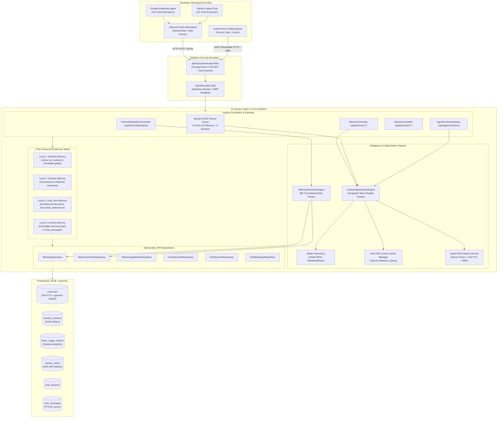
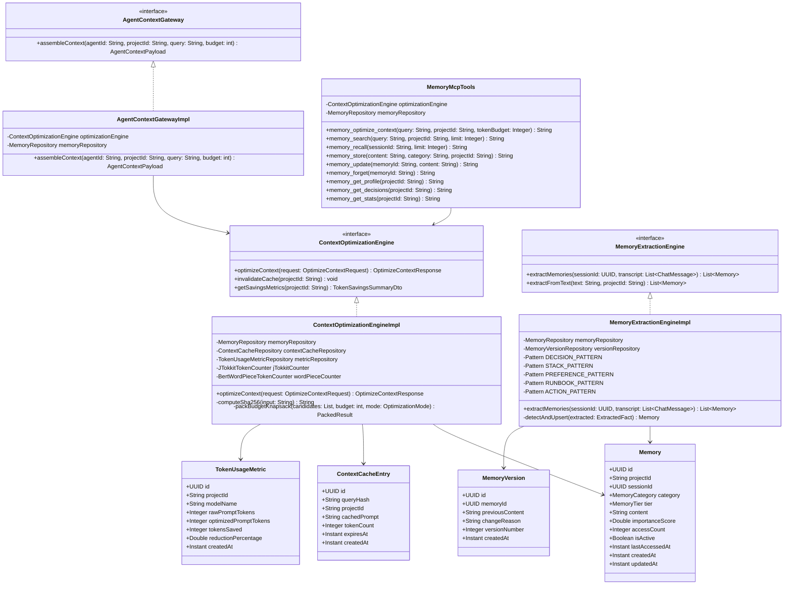
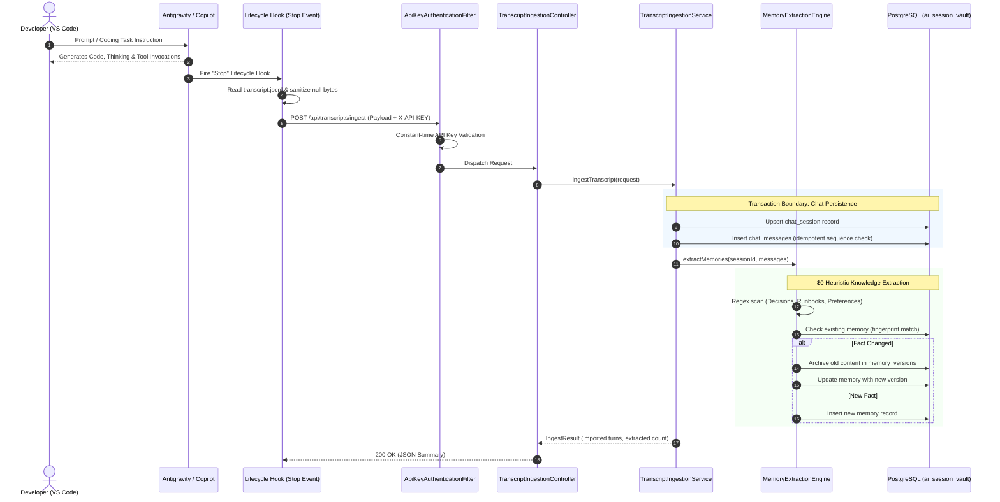
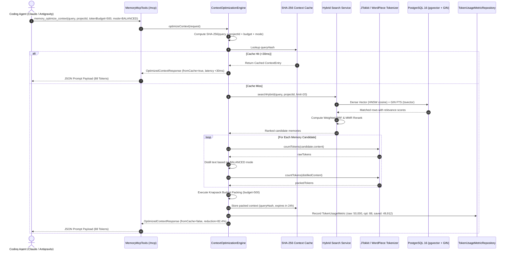
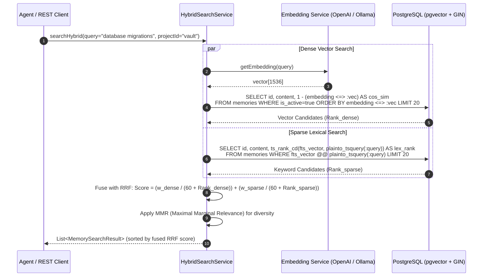
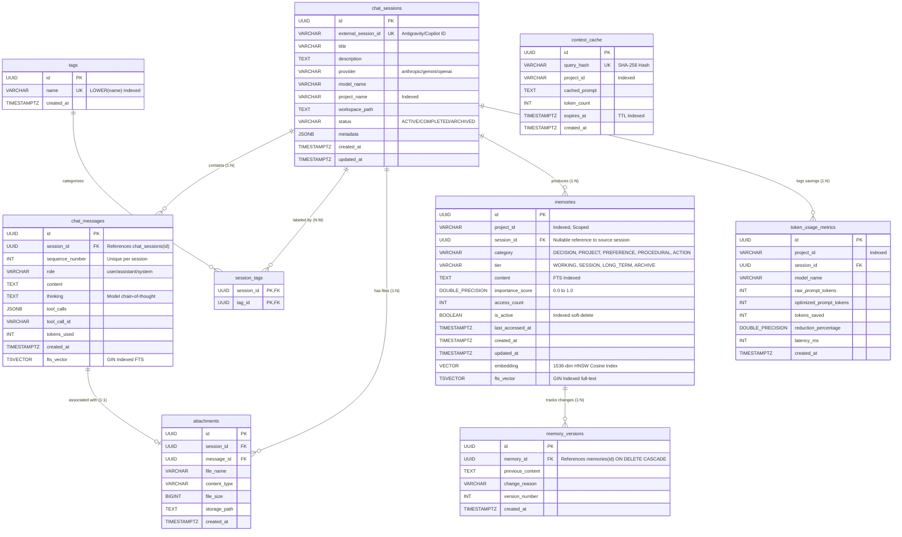
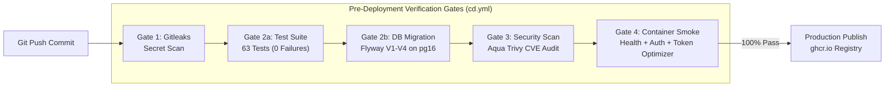

# System Architecture Design Document: AI Session Vault 2.0
### Intelligent Agent Memory, Hybrid RAG & Knapsack Token Optimization Platform

**Document Version:** 2.0.0  
**Status:** Approved & Production-Ready  
**Target Runtimes:** Java 21 LTS / Spring Boot 4.1.2 / Spring AI 2.0.1  
**Persistence Tier:** PostgreSQL 16/18 with `pgvector` & GIN Full-Text Search  
**Protocol Integrations:** Model Context Protocol (MCP 19 Tools), REST API, VS Code Lifecycle Hooks  

---

## 1. Executive Summary & Architectural Goals

**AI Session Vault 2.0** is an enterprise-grade conversation persistence, hierarchical memory, and token-budget optimization platform designed for autonomous AI agents (Google Antigravity, GitHub Copilot, Claude Code, Cursor) and developer engineering teams.

```
       +-------------------------------------------------------------+
       |                  DEVELOPER WORKSPACE (VS CODE)              |
       |     Google Antigravity  /  GitHub Copilot Chat Turns        |
       +------------------------------+------------------------------+
                                      | (Raw Transcripts: 50,000+ Tokens)
                                      v
       +-------------------------------------------------------------+
       |                   AI SESSION VAULT 2.0 CORE                 |
       |  +-------------------------------------------------------+  |
       |  |  4-Tier Memory Hierarchy (L1, L2, L3, L4 Archive)     |  |
       |  |  $0 Heuristic Memory Extraction Engine (Regex/AST)    |  |
       |  |  Knapsack Token Budget Optimizer (70%-90% Reduction)  |  |
       |  |  SHA-256 Context Cache (<30ms Latency)                |  |
       |  |  Spring AI MCP Server (19 Tools: 13 Memory + 6 Vault) |  |
       |  +-------------------------------------------------------+  |
       +------------------------------+------------------------------+
                                      | (Optimized Payload: <=800 Tokens)
                                      v
       +-------------------------------------------------------------+
       |               TARGET LARGE LANGUAGE MODELS (LLMs)           |
       |       Anthropic Claude 3.7  |  Google Gemini 2.5  | GPT-4o  |
       +-------------------------------------------------------------+
```

### 1.1 Core Engineering Goals
1. **Durable Multi-Tier Persistence**: Ingest and audit 100% of conversational turns, reasoning traces (`thinking`), and tool executions without blocking the developer's chat loop.
2. **70% to 90% Token Reduction**: Apply mathematical knapsack budget packing to compress historical transcripts down to strict token bounds with **zero silent overruns**.
3. **$0-LLM-Cost Knowledge Extraction**: Parse high-value architectural decisions, stack rules, developer preferences, and verified runbooks using deterministic heuristic extractors.
4. **Hybrid RAG Retrieval Engine**: Combine dense vector similarity (`pgvector` HNSW) with sparse lexical search (PostgreSQL GIN `tsvector`) fused via Weighted Reciprocal Rank Fusion (RRF) and Maximal Marginal Relevance (MMR).
5. **Universal Model Context Protocol (MCP) Support**: Provide 19 standard tools accessible over Streamable HTTP (`/mcp`) and stdio transport bridges.

---

## 2. High-Level Design (HLD)

### 2.1 System Context & High-Level Block Architecture



### 2.2 4-Tier Memory Hierarchy Architecture

```
+-----------------------------------------------------------------------------------------+
| LEVEL 1: WORKING MEMORY                                                                 |
| Scope: Current Turn / Active Task                                                       |
| Contents: User query, immediate agent thinking trace, open execution state              |
+-----------------------------------------------------------------------------------------+
                                           |
                                           v
+-----------------------------------------------------------------------------------------+
| LEVEL 2: SESSION MEMORY                                                                 |
| Scope: Conversation Session Lifecycle                                                   |
| Contents: Turn summaries, completed sub-tasks, unresolved action items, session tags    |
+-----------------------------------------------------------------------------------------+
                                           |
                                           v
+-----------------------------------------------------------------------------------------+
| LEVEL 3: LONG-TERM MEMORY (PROJECT-SCOPED)                                              |
| Scope: Permanent / Cross-Session Project Memory                                         |
| Contents: Architectural decisions (ADRs), tech stack rules, developer conventions,       |
|           verified runbook commands, historical version audits                          |
+-----------------------------------------------------------------------------------------+
                                           |
                                           v
+-----------------------------------------------------------------------------------------+
| LEVEL 4: COLD ARCHIVE MEMORY                                                            |
| Scope: Immutable Relational Storage                                                     |
| Contents: Raw JSONL message payloads, tool call inputs/outputs, token metrics           |
+-----------------------------------------------------------------------------------------+
```

---

## 3. Low-Level Design (LLD)

### 3.1 Class & Component Architecture



### 3.2 Algorithmic Specifications

#### 3.2.1 Knapsack Token Budget Packing Algorithm
The optimization engine treats memory inclusion as a **0/1 Knapsack Problem** where each candidate memory $m_i$ has:
- **Cost**: Exact token count $w_i = \text{Tokenize}(m_i, \text{Model})$.
- **Value**: Composite weight $V_i = \alpha \cdot \text{RelevanceScore}_i + \beta \cdot \text{ImportanceScore}_i + \gamma \cdot \text{RecencyBoost}_i$.
- **Constraint**: $\sum_{i \in \text{Selected}} w_i \le \text{tokenBudget}$.

```
Algorithm: KnapsackContextPacking
Input: candidates (List<Memory>), tokenBudget (int), mode (OptimizationMode), model (String)
Output: PackedContext (String, actualTokens, reductionPercentage)

1. Compute token count w_i for each memory m_i using target model tokenizer (JTokkit/WordPiece).
2. Apply mode distillation:
     - QUALITY_FIRST : retain exact text
     - BALANCED      : strip markdown filler, conversational boilerplate
     - AGGRESSIVE    : compress into compact key-value lines
3. Re-calculate distilled token cost w_i'.
4. Sort candidates descending by Value Density: D_i = V_i / w_i'.
5. Initialize currentTokens = 0, selected = [].
6. For each candidate m_i in sorted candidates:
     If currentTokens + w_i' <= tokenBudget:
         selected.append(m_i)
         currentTokens += w_i'
     Else if mode == AGGRESSIVE and remainingBudget > 15:
         Truncate m_i to remainingBudget, append, break.
7. Return FormatContext(selected), currentTokens, (1 - currentTokens/rawTokens)*100.
```

#### 3.2.2 $0-Cost Heuristic Knowledge Extraction Patterns
The extractor processes turns sequentially on the `Stop` event using pre-compiled regex automata:

| Category | Trigger Patterns & Heuristic Rules | Extracted Memory Representation |
|:---|:---|:---|
| `DECISION` | `(?i)(?:decided to\|we will use\|chosen\|architectural choice:)\s+(.+)` | Clean architectural statement with rationale |
| `PROJECT` | `(?i)(?:framework:\|database:\|port:\|version:\|stack:)\s+([a-zA-Z0-9_\-\.\s]+)` | Normalized tech stack key-value entry |
| `PREFERENCE` | `(?i)(?:prefer\|always use\|never use\|convention:)\s+(.+)` | Developer tooling convention rule |
| `PROCEDURAL` | `(?i)(?:runbook:\|verified command:\|to build:)\s*(?:```[\w]*\n)?([^`\n]+)` | Executable shell command runbook |
| `ACTION` | `(?i)(?:TODO:\|FIXME:\|next step:\|unresolved:)\s+(.+)` | Open backlog action item |

---

## 4. Sequence Diagrams

### 4.1 Automated VS Code Transcript Ingestion & Extraction Flow



### 4.2 Knapsack Token-Budget Optimization Flow



### 4.3 Hybrid RAG Search Flow with Dense Vector + GIN FTS



---

## 5. Complete Entity-Relationship (ER) Diagram



### 5.1 Database Index Specifications
1. **Full-Text Search (GIN)**:
   - `chat_messages.fts_vector`: GIN index on generated `to_tsvector('english', coalesce(content,'') || ' ' || coalesce(thinking,''))`.
   - `memories.fts_vector`: GIN index on generated `to_tsvector('english', coalesce(content,''))`.
2. **Dense Vector Embeddings (HNSW)**:
   - `memories.embedding`: `CREATE INDEX idx_memories_embedding ON memories USING hnsw (embedding vector_cosine_ops) WITH (m = 16, ef_construction = 64);`
3. **Idempotent Ingestion Unique Index**:
   - `CREATE UNIQUE INDEX uq_chat_messages_session_seq ON chat_messages (session_id, sequence_number);`
4. **Context Cache & Hash Lookups**:
   - `CREATE UNIQUE INDEX uq_context_cache_hash ON context_cache (query_hash);`
   - `CREATE INDEX idx_context_cache_ttl ON context_cache (expires_at);`

---

## 6. Enterprise CI/CD & Verification Gate Architecture



1. **Gate 1 (Gitleaks)**: Scans diffs and commit history for exposed credentials, API keys, or private tokens.
2. **Gate 2a (Unit & Integration Tests)**: Executes all 63 Spring Boot unit and integration tests using clean H2 in-memory profiles.
3. **Gate 2b (PostgreSQL Migration Dry-Run)**: Boots an ephemeral `pgvector/pgvector:pg16` container and runs all Flyway migrations (`V1` through `V4`) to guarantee schema integrity.
4. **Gate 3 (Trivy Container CVE Scan)**: Packages the multi-stage Alpine Docker image and audits against the CVE vulnerability database.
5. **Gate 4 (Live Smoke Test)**: Boots the actual application container, verifies `/actuator/health`, confirms security rejection (`401` on missing key), validates authorized access (`200` with `X-API-KEY`), and tests the Knapsack Token Budget Optimizer.
6. **Production Delivery**: Publishes release containers to GitHub Container Registry (`ghcr.io/livejpsingh/ai-session-vault`) only upon 100% gate pass.

---

## 7. Related Architectural Documents

- 📋 [Phase-Wise Implementation Plan](file:///c:/workspace/public/ai-session-vault/docs/PHASE_WISE_IMPLEMENTATION_PLAN.md)
- ⚙️ [CI/CD Pipeline & Pre-Deployment Verification Gates](file:///c:/workspace/public/ai-session-vault/docs/CI_CD_PIPELINE.md)
- 🏛️ [System Architecture Guide](file:///c:/workspace/public/ai-session-vault/docs/System-Architecture-Guide.md)
- 🛡️ [Production-Readiness Audit Report](file:///c:/workspace/public/ai-session-vault/docs/PRODUCTION_READINESS_REPORT.md)
- 💾 [Backup & Disaster Recovery Guide](file:///c:/workspace/public/ai-session-vault/docs/BACKUP_AND_RECOVERY.md)
