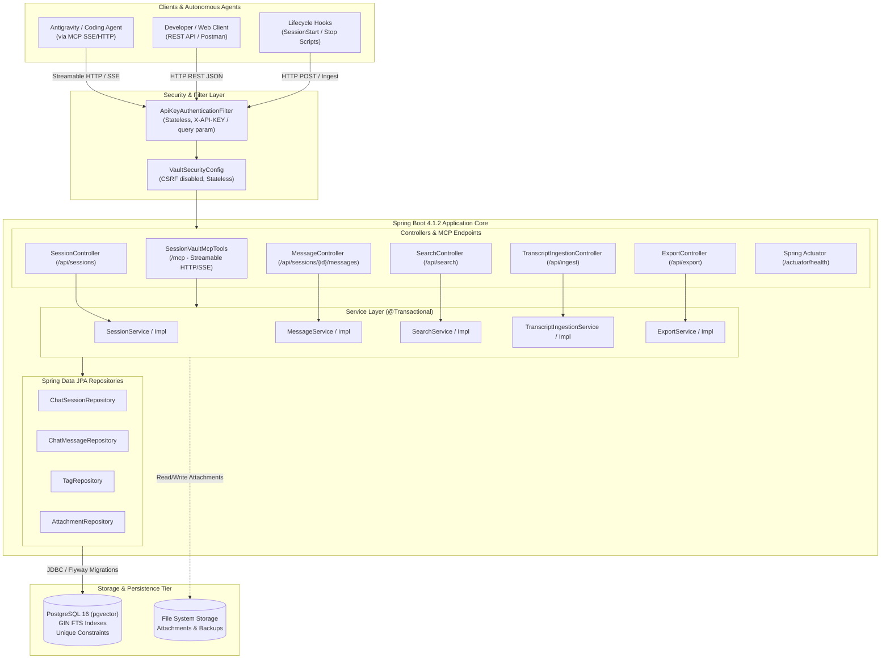
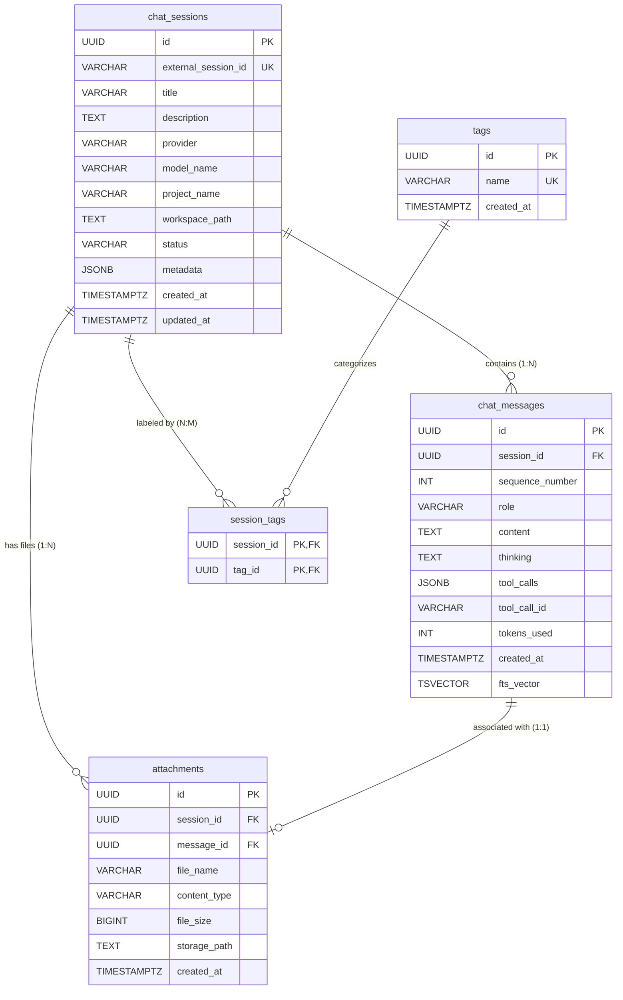
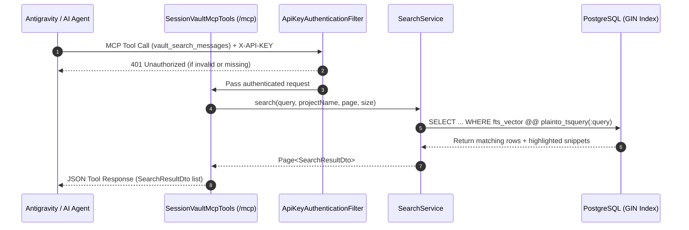
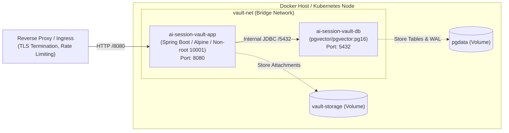

# Architecture Design Document: AI Session Vault

**Document Version:** 1.0.0  
**Status:** Approved & Implemented (Production-Ready)  
**System Target:** Spring Boot 4.1.2 / Java 21 LTS / Spring AI 2.0.1  
**Database:** PostgreSQL 16 with pgvector & GIN Full-Text Search  

---

## 1. Executive Overview

**AI Session Vault** is an enterprise-grade conversation memory server, ingestion pipeline, and audit platform designed for autonomous AI agents (such as Antigravity, Claude, and Gemini developer agents) and developer toolchains. It acts as a durable, queryable historical record store for AI coding sessions, providing full-text search, session lifecycle management, transcript ingestion, markdown/JSON export, and a native Model Context Protocol (MCP) tool provider for autonomous agent introspection.

### 1.1 Core Objectives
- **Durable Agent Memory**: Preserve complete agent conversational turns, chain-of-thought (`thinking`), tool call invocations, parameters, and results.
- **Agent Introspection via MCP**: Provide Spring AI MCP server endpoints allowing autonomous agents to query historical sessions, list previous solutions, and self-document ongoing tasks.
- **Sub-Second Full-Text Search**: Leverage native PostgreSQL `tsvector` and GIN indexing to search across millions of message tokens with zero external search cluster overhead.
- **Idempotent Ingestion**: Ingest raw conversation transcripts (`transcript.jsonl` or JSON formats) safely with deterministic sequence indexing and duplicate skipping.
- **Stateless Security**: Guard REST APIs and MCP streaming endpoints using constant-time API key authentication (`X-API-KEY` or EventSource query params).

---

## 2. High-Level System Architecture



---

## 3. Technology Stack

| Layer | Technology | Version | Purpose |
|---|---|---|---|
| **Runtime & Language** | Java (JDK) | 21 LTS | High-throughput virtual threads & modern Java syntax |
| **Framework** | Spring Boot | 4.1.2 | Core application runtime, dependency injection, and autoconfiguration |
| **Agent Protocol** | Spring AI MCP Server | 2.0.1 | Model Context Protocol provider (`streamable-http`) |
| **Security** | Spring Security | 6.x (Boot 4.1) | Stateless token filter, path authentication, and CORS/CSRF handling |
| **Data Persistence** | Spring Data JPA / Hibernate | 6.x | Entity mapping, `@EntityGraph` query optimization, repositories |
| **Database Migrations**| Flyway | 10.x | Deterministic, version-controlled database schema migrations |
| **Database Engine** | PostgreSQL (pgvector) | 16 | Relational storage, Full-Text Search (`tsvector`), GIN indexing, vector-ready |
| **Containerization** | Docker & Compose | Multi-stage | Alpine non-root container with JVM container support |

---

## 4. Domain Model & Database Schema

The database design is versioned with Flyway (`V1__init_schema.sql` and `V2__add_constraints_and_indexes.sql`) enforcing relational integrity, unique sequence constraints, and performant indexes.



### 4.1 Key Schema Constraints & Indexes
1. **Full-Text Search (FTS) Index**:
   ```sql
   fts_vector TSVECTOR GENERATED ALWAYS AS (
       to_tsvector('english', coalesce(content, '') || ' ' || coalesce(thinking, ''))
   ) STORED;
   CREATE INDEX idx_chat_messages_fts ON chat_messages USING GIN (fts_vector);
   ```
   Enables sub-millisecond lexical queries over both final output text and hidden model reasoning (`thinking`).
2. **Sequence Number Integrity**:
   ```sql
   CREATE UNIQUE INDEX uq_chat_messages_session_seq ON chat_messages (session_id, sequence_number);
   ```
   Prevents duplicate message writes or sequence drift during concurrent or repeated transcript ingestion.
3. **Optimized Lookup Indexes**:
   - `idx_chat_sessions_external_id`: Unique index for looking up Antigravity conversation IDs.
   - `idx_chat_sessions_project`: Accelerated filtering across multiple projects.
   - `idx_tags_name_lower`: Fast case-insensitive tag lookups via `LOWER(name)`.

---

## 5. Subsystem Architecture

### 5.1 Model Context Protocol (MCP) Subsystem
The MCP layer bridges autonomous agent runtimes with the database:
- **Transport**: `streamable-http` (SSE over HTTP) served on `/mcp`.
- **Tools Exposed (`SessionVaultMcpTools`)**:
  - `vault_search_messages`: Full-text search with pagination and project filtering.
  - `vault_get_session`: Retrieve session details and message history by UUID or external conversation ID.
  - `vault_list_sessions`: List sessions with project, provider, or tag filters.
  - `vault_ingest_transcript`: Parse and persist transcript files from disk or raw JSONL payloads.
  - `vault_export_session`: Export complete session logs to Markdown or JSON.
  - `vault_save_message`: Append an individual prompt/response turn dynamically.



### 5.2 Transcript Ingestion Engine
The ingestion engine reconciles external agent execution transcripts with the database:
1. **Path Traversal Shield**: Strictly verifies incoming `filePath` strings to ensure they are regular files, readable, and do not contain traversal sequences (`..`).
2. **Streaming Parser**: Parses line-by-line JSONL streams (compatible with standard Antigravity transcripts).
3. **Deduplication Engine**: Compares existing sequence numbers and calculates deterministic message signatures. If a session is re-ingested, already-stored messages are skipped (`duplicatesSkipped`), ensuring idempotent execution.

### 5.3 Full-Text Search Engine
- Search queries use PostgreSQL's `plainto_tsquery('english', :query)`.
- Avoids dynamic SQL string concatenation by relying on Spring Data JPA native queries with named parameters.
- Produces search results containing session metadata, matching roles, sequence numbers, and text snippets.

### 5.4 Export Engine
Supports exporting sessions into developer-friendly representations:
- **MARKDOWN**: Hierarchical document containing session headers, tags, metadata, user prompts, assistant reasoning callouts (collapsible `<details><summary>Thinking Process</summary></details>`), and tool invocation blocks.
- **JSON**: Complete machine-readable serialized export of the session tree and attachments.

---

## 6. Security Architecture

### 6.1 Authentication Mechanism
- Stateless API Key Authentication via `ApiKeyAuthenticationFilter`.
- Supported authentication channels:
  1. Header: `X-API-KEY: <key>` (preferred for REST API calls).
  2. Header: `Authorization: Bearer <key>`.
  3. Query Parameter: `?apiKey=<key>` (required for SSE / `EventSource` MCP connections where custom headers cannot be set in browser/certain client contexts).
- Constant-time comparison (`MessageDigest.isEqual`) prevents timing attacks.

### 6.2 Endpoint Access Policy

| Endpoint Pattern | Method | Authentication Required | Notes |
|---|---|---|---|
| `/actuator/health/**` | GET | **No** (PermitAll) | Used for Docker and K8s liveness/readiness probes |
| `/actuator/info` | GET | **No** (PermitAll) | Basic build and app metadata |
| `/swagger-ui/**`, `/v3/api-docs/**` | GET | **No** (PermitAll) | API documentation |
| `/mcp/**` | GET, POST | **Yes** (API Key) | MCP tool endpoints and EventStreams |
| `/api/**` | ALL | **Yes** (API Key) | Core REST APIs |

### 6.3 Data Protection & Error Handling
- `GlobalExceptionHandler` intercepts all unhandled runtime exceptions and returns sanitized JSON error models (`ErrorResponse`), preventing internal stack traces or database connection details from leaking to callers.

---

## 7. Performance & Query Optimization

1. **Elimination of $N+1$ Query Hazards**:
   - `ChatSessionRepository.countBySessionId(UUID)` computes message counts directly in SQL instead of lazy-loading message collections.
   - `@EntityGraph(attributePaths = {"tags"})` ensures that session tags are fetched in a single joined query rather than triggering subsequent `SELECT` calls per session.
2. **Virtual Threads Support**:
   - Enabled via `spring.threads.virtual.enabled: true` in Spring Boot 4 / Java 21, allowing concurrent handling of streaming MCP SSE connections with minimal OS thread overhead.
3. **Database Index Coverage**:
   - Every foreign key and filter predicate (`status`, `project_name`, `provider`, `model_name`, `created_at`) is indexed.

---

## 8. Deployment & Operational Architecture



### 8.1 Docker Deployment
- **Multi-Stage Build**: Base image `eclipse-temurin:21-jre-alpine`.
- **Security Hardening**: Runs as unprivileged system user `vault:10001`.
- **Container Memory Awareness**: Configured with `-XX:+UseContainerSupport` and `-XX:MaxRAMPercentage=75.0`.
- **Health Checks**: Automated `curl` healthcheck probe against `/actuator/health` with `depends_on: postgres: service_healthy` orchestration.

### 8.2 Backup & Disaster Recovery
- Logical automated dumps via `scripts/backup.sh` (Linux) and `scripts/backup.ps1` (PowerShell).
- Detailed restore procedures and PITR guidelines documented in [docs/BACKUP_AND_RECOVERY.md](file:///c:/workspace/public/ai-session-vault/docs/BACKUP_AND_RECOVERY.md).

---

## 9. Related Architectural Documents

- [Production Readiness Audit Report](file:///c:/workspace/public/ai-session-vault/docs/PRODUCTION_READINESS_REPORT.md)
- [Backup and Recovery Guide](file:///c:/workspace/public/ai-session-vault/docs/BACKUP_AND_RECOVERY.md)
