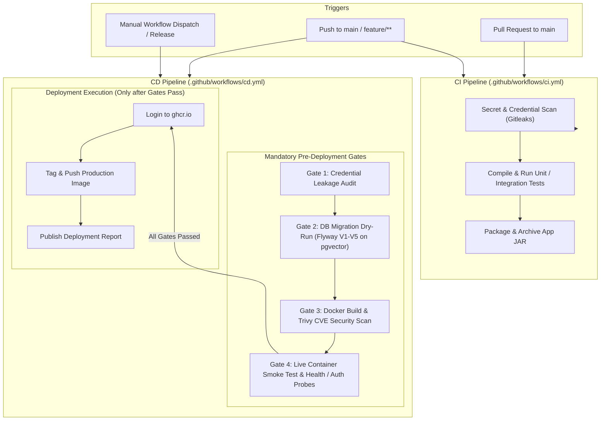

# CI/CD Pipeline & Pre-Deployment Verification Gates

## Overview

AI Session Vault 2.0 incorporates an enterprise-grade Continuous Integration (CI) and Continuous Delivery (CD) pipeline built with **GitHub Actions**.

The core requirement of this pipeline is **strict pre-deployment verification**: before any code is deployed to staging, production, or published as a container image to GitHub Container Registry (`ghcr.io`), it must pass through 4 automated pre-deployment verification gates.

---

## 1. Pipeline Architecture

---

## 2. CI Pipeline (`.github/workflows/ci.yml`)

The CI workflow triggers on every push and pull request to maintain high code quality:
1. **Secret & Credential Scan:** Runs Gitleaks across the git commit history to detect accidentally exposed API keys, passwords, or tokens.
2. **PostgreSQL 16 + pgvector Service Container:** Automatically boots a real PostgreSQL instance with pgvector support inside the GitHub runner.
3. **Automated Testing:** Runs `mvn clean test` executing all repository, service, and controller tests.
4. **Artifact Archival:** Publishes Surefire XML test reports and the built application JAR (`ai-session-vault-0.0.1-SNAPSHOT.jar`).

---

## 3. CD Pipeline & Pre-Deployment Verification Gates (`.github/workflows/cd.yml`)

The CD workflow ensures that **no broken, vulnerable, or untested build is ever deployed**.

### Gate 1: Secret & Credential Leakage Audit
- Scans all incoming commits for hardcoded secrets before deployment initialization.

### Gate 2: Database Migration Dry-Run & Schema Integrity
- Spins up a clean `pgvector/pgvector:pg16` container.
- Applies Flyway migrations `V1`, `V2`, `V3`, `V4`, and `V5`.
- Queries the PostgreSQL system catalog to verify all required tables and multi-tenancy columns exist:
  * `chat_sessions` (with `tenant_id`)
  * `chat_messages` (with `tenant_id`)
  * `session_chunks`
  * `memories` (with `tenant_id`)
  * `memory_versions`
  * `token_usage_metrics` (with `tenant_id`)
  * `context_cache` (with `tenant_id`)
  * `outbox_events` (for transactional event dispatching)

### Gate 3: Docker Container Build & Security Scanning (Trivy)
- Packages the Spring Boot JAR and builds the container image using the multi-stage Alpine Dockerfile.
- Runs **Aqua Security Trivy** to scan OS packages and application dependencies for `CRITICAL` or `HIGH` CVEs.

### Gate 4: Container Smoke Test & Live Integration Probe
Runs the container in an isolated Docker bridge network alongside PostgreSQL and executes live HTTP probes:
1. **Health Probe:** Polls `http://localhost:8080/actuator/health` until `{"status":"UP"}` is confirmed.
2. **Security Gate:** Asserts that accessing `/api/sessions` without an API key returns `HTTP 401 Unauthorized`.
3. **Authentication Gate:** Asserts that accessing `/api/sessions` with `X-API-KEY` returns `HTTP 200 OK`.
4. **Token Optimizer Probe:** Sends a sample request to `POST /api/memory/optimize-context` and validates JSON response within the 500-token budget.
5. **MCP Discovery Probe:** Verifies `/.well-known/oauth-protected-resource` responds with discovery metadata.

---

## 4. Production Delivery to GitHub Container Registry

Once all 4 pre-deployment gates pass:
- Authenticates with GitHub Container Registry (`ghcr.io`) using the build runner's `GITHUB_TOKEN`.
- Tags the image with:
  * `latest` (default branch)
  * `sha-<git-short-sha>`
  * Release version tag (on semver release events)
- Pushes the production container image to `ghcr.io/<repository-owner>/ai-session-vault`.
