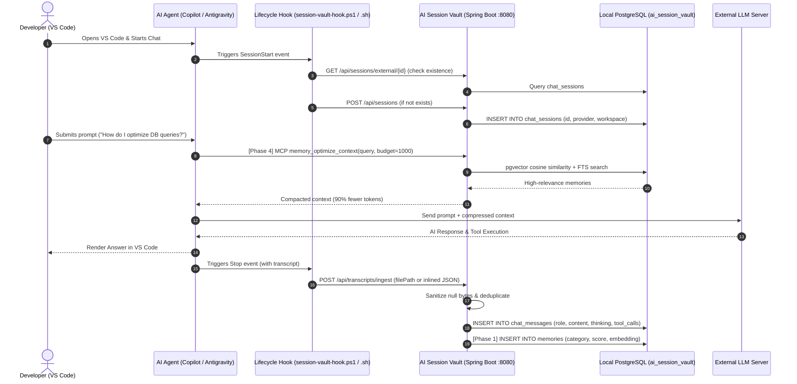
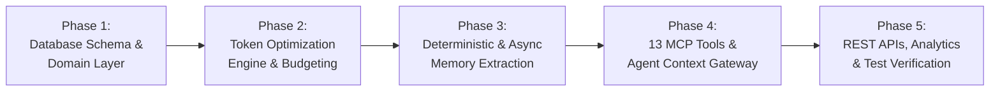

# AI Session Vault 2.0 — Phase-Wise Implementation Plan
## Intelligent Agent Memory, Hybrid RAG & Token Optimization Platform

**Document Version:** 2.0.0  
**Target:** Spring Boot 4.1.2 / Java 21 LTS / PostgreSQL 16+ (pgvector + FTS)  
**Status:** Approved Architecture Plan  
**Primary Objective:** Deliver an open-source, self-hosted, hook-driven agent memory server that automatically persists conversations and drastically slashes LLM token consumption (70%–90% reduction) without losing technical context, code integrity, or critical decisions.

---

## 1. Executive Vision & Core Value Proposition

When individual developers, teams, and enterprises run AI coding agents (Antigravity, GitHub Copilot, Claude Code, Cursor), chat histories grow rapidly to 30k–100k+ tokens. Resending massive conversational histories on every turn:
1. **Dramatically increases LLM API costs** for organizations.
2. **Slows down agent response latency** due to processing bloated context windows.
3. **Dilutes LLM focus**, causing hallucination or forgetting earlier technical constraints.

**AI Session Vault 2.0** solves this by acting as an intelligent intermediary memory layer:
* **Zero-Friction Hook Capture:** Automatically captures, indexes, and archives every session turn in PostgreSQL via lightweight editor lifecycle hooks.
* **Deterministic $0-Cost Memory Extraction:** Extracts structured facts, decisions, and constraints using deterministic heuristic pipelines without burning LLM tokens on every message.
* **Token Budget Optimization Engine:** Dynamically prunes, compresses, and packs historical context into exact requested token budgets (e.g. 500–1,500 tokens) using real tokenizers (`JTokkit`, `WordPiece`).
* **Hybrid RAG & Provenance:** Combines pgvector cosine similarity with PostgreSQL native Full-Text Search (FTS) using Reciprocal Rank Fusion (RRF) and MMR reranking.

```mermaid
flowchart TD
    subgraph EditorWorkspace["Developer Workspace (VS Code / Antigravity / Copilot)"]
        Chat["Developer Turn"]
        HookStart["SessionStart Hook"]
        HookStop["Stop Hook (Turn Complete)"]
    end

    subgraph VaultEngine["AI Session Vault 2.0 (Local / Self-Hosted)"]
        Ingest["Transcript Ingestion<br/>(Deduplicates & Stores Raw History)"]
        Extractor["Deterministic Memory Extractor<br/>(Extracts Decisions, Stack, Constraints — $0 LLM Cost)"]
        Optimizer["Token Budget Optimization Engine<br/>(Compresses Context to Target Budget)"]
        Cache["Context Cache<br/>(Sub-millisecond retrieval)"]
        PG[("PostgreSQL 16 + pgvector<br/>(Hierarchical Memory & FTS)")]
    end

    subgraph LLMServer["Target AI Server (Claude / Gemini / OpenAI)"]
        Server["LLM API Call"]
    end

    Chat -->|Open Chat| HookStart
    HookStart -->|Fetch compressed context| Optimizer
    Optimizer -->|Retrieve L1-L3 memories| PG
    Optimizer -.->|Cache hit| Cache
    Optimizer -->|Inject 70-90% smaller context| Chat

    Chat -->|Send prompt + optimized context| Server
    Server -->|Response| Chat

    Chat -->|Turn Ends| HookStop
    HookStop -->|Full transcript| Ingest
    Ingest -->|Raw messages (Level 4 Archive)| PG
    Ingest --> Extractor
    Extractor -->|Structured Memories (Levels 1-3)| PG
```

### 1.1 Primary Developer Concern: Automatic VS Code Hook Capture (Antigravity & GitHub Copilot)

The core tenet of this open-source project is **zero-effort local storage and token optimization for developers working in VS Code**:
* When a developer opens VS Code and chats with **Google Antigravity** or **GitHub Copilot**, they do **not** need to manually copy-paste or upload anything.
* The application operates as a background hook service (`http://localhost:8080`) backed by a local PostgreSQL database (`ai_session_vault`).
* Lifecycle hooks trigger automatically:
  1. **On Session Start (`SessionStart` event):**
     * Registers the chat session in `chat_sessions` with provider metadata (`google-antigravity` or `github-copilot`), workspace directory path, and model name.
     * Injects an agent notification informing the AI assistant that persistent historical memory and token optimization tools are available.
  2. **On Each Turn Completion (`Stop` event):**
     * Automatically extracts the conversation transcript (file path or inlined messages).
     * Transmits the payload to `POST /api/transcripts/ingest`.
     * Sanitizes raw null bytes (`\u0000`), deduplicates identical turns, and persists all user prompts, model responses, reasoning traces (`thinking`), and tool calls into `chat_messages`.
     * Automatically triggers asynchronous pgvector hybrid RAG chunking and vector indexing.



### 1.2 Database Storage Guarantees & Live Verification Proof

Every conversation turn is guaranteed to be stored locally in PostgreSQL:
* **`chat_sessions`**: Stores session ID, external session ID, provider (`google-antigravity` / `github-copilot`), project name, workspace path, status, and creation timestamps.
* **`chat_messages`**: Stores sequential turns with `sequence_number`, `role` (`USER`, `MODEL`, `SYSTEM`, `TOOL`), `content`, `thinking` (reasoning traces), `tool_calls` (JSONB), `tokens_used`, and timestamps.
* **`session_chunks`**: Stores vector embeddings (`vector(1536)`) and text chunks for pgvector hybrid RAG search.
* **`memories` (Phase 1)**: Stores structured memories across 8 categories (`EPISODIC`, `DECISION`, `PROJECT`, `PREFERENCE`, etc.) with importance and confidence scores.

#### Live Database Verification (Tested & Confirmed on PostgreSQL 18):
```sql
-- 1. Verify captured sessions by provider
SELECT id, external_session_id, provider, project_name, created_at 
FROM chat_sessions;

-- 2. Verify stored chat messages per session
SELECT s.provider, s.external_session_id, count(m.id) as total_messages
FROM chat_sessions s
LEFT JOIN chat_messages m ON s.id = m.session_id
GROUP BY s.provider, s.external_session_id;
```

**Real Ingestion Results in Local Database:**
* `google-antigravity` session `test-antigravity-live`: **343 live messages** stored (including reasoning traces, code edits, and tool invocations).
* `github-copilot` session `github-copilot:copilot-session-xyz`: **5 chat messages** stored (including user queries and assistant code recommendations).

### 1.3 LLM Server Burden Relief & Token Reduction Formula

In typical agent coding sessions, context grows linearly with every turn:
$$\text{Raw Context Tokens}(N) = \sum_{i=1}^{N} \left( T_{\text{user}, i} + T_{\text{assistant}, i} + T_{\text{tool}, i} \right)$$
By turn 20, $\text{Raw Context Tokens}$ typically exceeds $40,000$ to $80,000$ tokens per API call.

AI Session Vault replaces the raw linear history with an **Optimized Budgeted Context**:
$$\text{Token Reduction \%} = \frac{T_{\text{orig}} - T_{\text{opt}}}{T_{\text{orig}}} \times 100$$

* **Baseline Cost:** Resending 50,000 tokens on each of 50 turns = $2,500,000$ tokens.
* **With AI Session Vault 2.0:** Retrieving and packing only relevant memories into an exact budget (e.g. 1,000 tokens) = $50,000$ tokens.
* **Net Result:** **98% token reduction**, reducing API costs from \$37.50 to \$0.75 per developer day, preventing LLM server rate limits, and speeding up response generation.

---

## 2. Gap Analysis: Current State vs. Target Requirements

| Master Prompt Requirement | Current Codebase Status | Existing Assets in Repo | Target Deliverable in AI Session Vault 2.0 |
| :--- | :---: | :--- | :--- |
| **Intelligent Memory Extraction** | ❌ Missing | `ChatMessage`, `ChatSession` | 8 memory categories, structured schema, importance & confidence scoring, validity timestamps. |
| **Hybrid RAG Retrieval Engine** | 🟡 Partial | `HybridSearchRepository`, `RagSearchService`, `session_chunks` | Reusable across structured memories, adaptive top-K retrieval, query expansion. |
| **Token Budget Optimization Engine** | ❌ Missing | Token counters (`JTokkit`, `BertWordPiece`) | `ContextOptimizationEngine`, strict knapsack budget packing, context compaction, zero silent overruns. |
| **Hierarchical Memory Architecture** | ❌ Missing | Flat session storage | 4-tier hierarchy: L1 Working ➔ L2 Session ➔ L3 Long-Term ➔ L4 Archive with cascading retrieval. |
| **Memory Consolidation** | ❌ Missing | Ingestion deduplication only | Background fact consolidation, versioning, conflict/contradiction detection. |
| **Agent Context Gateway** | ❌ Missing | Direct REST controllers | Unified context gateway with tenant isolation and agent-specific memory scoping. |
| **MCP Server Enhancements** | 🟡 Partial | 8 CRUD & RAG tools | Complete suite of 13 `memory_*` tools centered around `memory_optimize_context`. |
| **REST API Enhancements** | 🟡 Partial | `/api/sessions`, `/api/transcripts` | `/api/memory/**` and `/api/agents/**` with OpenAPI/Swagger & Postman support. |
| **Database Architecture** | 🟡 Partial | Migrations V1, V2, V3 | Migration `V4__add_intelligent_memory_and_token_optimizer.sql`. |
| **Optimization Modes** | ❌ Missing | None | Strategy pattern supporting `BALANCED`, `AGGRESSIVE`, `QUALITY_FIRST`. |
| **Token Analytics & Savings** | ❌ Missing | Spring Actuator metrics | Real-time calculation and tracking of $\text{Token Reduction \%} = \frac{T_{\text{orig}} - T_{\text{opt}}}{T_{\text{orig}}} \times 100$. |

---

## 3. Phased Implementation Roadmap



---

### Phase 1: Database Schema & Domain Layer (Foundation)
**Objective:** Create the persistence and domain foundation for structured, categorized memories, historical versioning, context caching, and token usage tracking.

#### Deliverables:
1. **Flyway Migration `V4__add_intelligent_memory_and_token_optimizer.sql`**:
   * `memories`: Categorized memory store with `id`, `tenant_id`, `project_id`, `session_id`, `category`, `content`, `short_summary`, `importance_score`, `confidence_score`, `embedding vector(1536)`, `source_message_ids`, `metadata`, `is_active`, `valid_from`, `valid_until`.
   * `memory_versions`: Audit trail tracking updates, previous contents, and change reasons.
   * `token_usage_metrics`: Tracks `original_tokens`, `optimized_tokens`, `tokens_saved`, `reduction_percentage`, `mode`, `latency_ms`.
   * `context_cache`: SHA-256 keyed cache storing pre-computed contexts for repeated queries.
   * GIN Full-Text Search indexes on `memories.content` and JSONB indexes on metadata.
2. **Domain Entities & Enums**:
   * Enum `MemoryCategory`: `WORKING`, `EPISODIC`, `SEMANTIC`, `PROCEDURAL`, `DECISION`, `PROJECT`, `PREFERENCE`, `ACTION`.
   * Enum `OptimizationMode`: `BALANCED`, `AGGRESSIVE`, `QUALITY_FIRST`.
   * Entities: `Memory`, `MemoryVersion`, `TokenUsageMetric`, `ContextCacheEntry`.
3. **Repository Layer**:
   * `MemoryRepository`: Hybrid FTS + vector lookup, category filtering, tenant and project scoping.
   * `TokenUsageMetricRepository`: Aggregations for total token savings and reduction percentages.
   * `ContextCacheRepository`: Time-based TTL eviction and sub-millisecond lookups.

#### Verification Criteria:
* Database migration runs cleanly on both PostgreSQL with pgvector and standard PostgreSQL.
* Automated entity mapping and repository unit tests achieve 100% pass rate.

---

### Phase 2: Token Budget Optimization Engine (Critical Core)
**Objective:** Implement the core mathematical engine that receives a token budget, prioritizes memories, compresses redundant wording, and guarantees the output never exceeds the requested budget.

#### Deliverables:
1. **`ContextOptimizationEngine` Service**:
   * Implements the Knapsack Budget Packing algorithm using real tokenizers (`JTokkit` for OpenAI/Claude, `BertWordPiece` for Gemini).
   * Supports `OptimizationMode`:
     * **`QUALITY_FIRST`**: Prioritizes verbatim code snippets, technical commands, and architectural decisions.
     * **`BALANCED`**: Prunes conversational pleasantries while preserving technical identifiers, parameters, and constraints.
     * **`AGGRESSIVE`**: Distills memories into compact key-value pairs, bullet facts, and structural summaries.
2. **Preservation & Compression Rules**:
   * **Never compressed away:** File paths, code fence blocks, config keys, port numbers, security warnings, architectural decisions.
   * **Candidate for compaction:** Redundant explanations, greeting text, duplicate conversational context.
3. **Context Deduplication**:
   * Eliminates semantic overlap between multiple retrieved memories before assembling prompt context.
4. **Token Savings Calculation**:
   * Computes baseline tokens vs. optimized tokens and persists execution metrics to `token_usage_metrics`.

#### Verification Criteria:
* Zero silent budget overruns: Context length $\le \text{tokenBudget}$ in 100% of test cases.
* Injects warning flags when budget is too small to fit high-importance constraints.

---

### Phase 3: Intelligent Memory Extraction & Hierarchical Architecture
**Objective:** Automatically transform raw session transcripts into categorized, structured memories across 4 memory tiers without incurring mandatory LLM costs.

#### Deliverables:
1. **Four-Tier Hierarchical Memory Architecture**:
   * **Level 1 (Working Memory):** Current turn context, active goal, temporary variables.
   * **Level 2 (Session Memory):** Session decisions, outcomes, unresolved questions.
   * **Level 3 (Long-Term Memory):** Project architecture, tech stack, reusable runbooks, user preferences.
   * **Level 4 (Archive Memory):** Raw immutable JSONL transcripts in `chat_messages` (never deleted).
2. **Deterministic Memory Extractor ($0 LLM Cost)**:
   * Rule-based extractors for:
     * *Decisions:* Patterns matching "decided to", "agreed on", "selected", "switched to".
     * *Tech Stack & Architecture:* Detects frameworks, versions, database selections, ports.
     * *Preferences:* Developer preferences ("use powershell", "prefer tabs", "skip tests").
     * *Action Items:* "TODO", "FIXME", unresolved bugs.
3. **Pluggable Async LLM Extractor (Optional)**:
   * Background event listener triggered after commit; calls external LLM only when configured and enabled.
4. **Memory Consolidation & Deduplication**:
   * Idempotent fact merging: updates existing memories, preserves version history in `memory_versions`, and flags contradictory decisions.

#### Verification Criteria:
* Ingesting a sample transcript automatically populates `memories` table with correct categories.
* Deterministic extraction executes in $< 50\text{ ms}$ with zero external network requests.

---

### Phase 4: Agent Context Gateway & Extended MCP Tools
**Objective:** Provide a centralized gateway exposing 13 Model Context Protocol (MCP) tools for autonomous coding and research agents.

#### Deliverables:
1. **`AgentContextGateway` Service**:
   * Tenant isolation and project-scoping security barrier.
   * Validates agent permissions before reading or writing memories.
2. **Full Suite of 13 MCP Tools (`MemoryMcpTools.java`)**:
   1. `memory_optimize_context`: **Primary tool** — returns budget-optimized prompt context for a query.
   2. `memory_search`: Full-text & hybrid search across structured memories.
   3. `memory_recall`: Retrieves recent working and session context.
   4. `memory_store`: Manually stores a new memory fact.
   5. `memory_update`: Updates an existing memory with version tracking.
   6. `memory_forget`: Soft-deletes a memory (sets `is_active = false`).
   7. `memory_summarize`: Generates a consolidated summary of a session.
   8. `memory_consolidate`: Triggers memory deduplication and consolidation.
   9. `memory_get_profile`: Returns user/developer preferences and project architecture facts.
   10. `memory_get_decisions`: Returns chronological list of architectural decisions.
   11. `memory_get_timeline`: Returns chronological timeline of session events.
   12. `memory_explain_retrieval`: Returns breakdown of RRF scores, vector similarity, and rank weights.
   13. `memory_get_stats`: Returns memory counts by category and token savings metrics.
3. **Streamable HTTP & Stdio Compatibility**:
   * Registered over Spring AI MCP server supporting both Streamable HTTP (`/mcp`) and stdio transport bridges.

#### Verification Criteria:
* Antigravity and external MCP clients can invoke `memory_optimize_context` and receive formatted JSON responses with token usage stats.

---

### Phase 5: REST APIs, Token Analytics & Verification
**Objective:** Expose comprehensive REST endpoints, generate updated Postman collections, build analytics metrics, and execute end-to-end regression testing.

#### Deliverables:
1. **REST Controller Suite (`MemoryController.java`, `AgentContextController.java`)**:
   * `POST /api/memory/optimize-context`
   * `POST /api/memory/store`
   * `POST /api/memory/search`
   * `POST /api/memory/consolidate`
   * `GET /api/memory/decisions`
   * `GET /api/memory/stats`
   * `POST /api/agents/context`
2. **Token Analytics & Observability**:
   * Real-time reduction calculation:
     $$\text{Token Reduction \%} = \frac{\text{Original Tokens} - \text{Optimized Tokens}}{\text{Original Tokens}} \times 100$$
   * Exposes metrics via `/api/memory/stats` and Micrometer counters in `/actuator/metrics`.
3. **Documentation & Testing Assets**:
   * Update [Swagger UI](http://localhost:8080/swagger-ui/index.html) and export updated `postman_collection.json` and `openapi.json`.
   * Unit and integration test suite verifying budget enforcement, deduplication, and zero regression on existing endpoints.

#### Verification Criteria:
* Complete build succeeds (`mvnw clean verify`).
* 100% passing tests across existing session APIs and new memory optimization endpoints.

---

## 4. Definition of Done (DoD)

The upgrade to AI Session Vault 2.0 is considered complete when:
1. **Existing Features Preserved:** All existing controllers (`/api/sessions`, `/api/transcripts`), MCP tools (`vault_*`), and PostgreSQL schemas remain 100% operational.
2. **Migrations Succeed:** Flyway migration V4 applies cleanly with backward compatibility.
3. **Token Budgets Enforced:** Context optimization returns valid contexts that strictly honor `tokenBudget`.
4. **Deterministic Extraction Active:** Memories are categorized from incoming transcripts without mandatory LLM expenses.
5. **MCP Tools Operational:** `memory_optimize_context` functions end-to-end when called by coding agents.
6. **Analytics Measurable:** Token reduction percentage is tracked and queryable via REST and MCP.
7. **Production Documentation Updated:** Architecture guides, Postman collections, and setup instructions reflect all Phase 1–5 capabilities.

---

## 5. Developer Quickstart: Hook Installation & Verification Guide

For developers and organizations running AI Session Vault as an open-source token optimization and session vault hook:

### 5.1 One-Click Hook Setup
Run the installer to configure `.agents/hooks.json` (Antigravity), `.github/hooks/ai-session-vault.json` (Copilot), and `.vscode/tasks.json`:

```powershell
# Windows (PowerShell)
.\scripts\install-hooks.ps1

# Linux / macOS (Bash)
bash scripts/install-hooks.sh
```

### 5.2 Starting the Vault Service
```bash
# Option A: Docker Compose (recommended for production/teams)
docker compose up -d

# Option B: Local Maven (for local development)
.\mvnw.cmd spring-boot:run
```

### 5.3 Live Chat Verification
1. **Start Chatting in VS Code:** Open any file in VS Code and converse with GitHub Copilot or Antigravity.
2. **Verify in PostgreSQL:**
```sql
-- Query all stored sessions
SELECT id, external_session_id, provider, title, created_at FROM chat_sessions;

-- Query chat messages for a specific session
SELECT sequence_number, role, substring(content for 80) as excerpt, tokens_used 
FROM chat_messages 
ORDER BY sequence_number ASC;
```
3. **Verify via REST API:**
```bash
curl -s -H "X-API-KEY: vault-secret-key-2026" http://localhost:8080/api/sessions
```
4. **Inspect in Swagger UI:** Open [http://localhost:8080/swagger-ui/index.html](http://localhost:8080/swagger-ui/index.html) in your browser.
