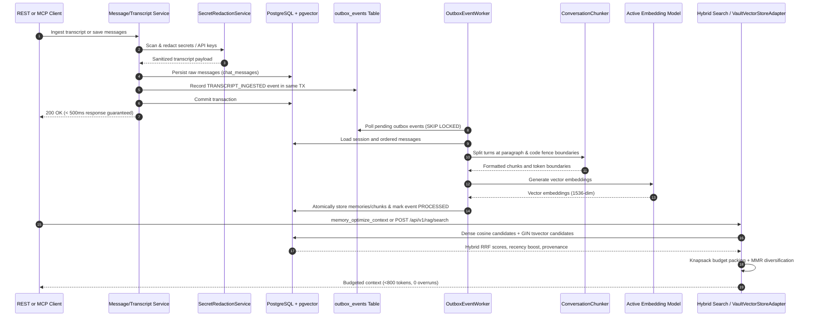

# AI Session Vault 3.0 — Semantic Memory & Enterprise Architecture Guide

## Overview

The semantic memory and context optimization path in **AI Session Vault 3.0** augments the existing PostgreSQL full-text search without replacing the existing REST or MCP APIs. Raw transcripts and messages remain the immutable source of truth in `chat_sessions` and `chat_messages`. Indexed turn-aware chunks are stored in `session_chunks` and structured hierarchical facts are stored in `memories`, with pgvector HNSW embeddings, generated full-text GIN vectors, and provenance back to the source session.

Workspace lifecycle hooks for GitHub Copilot (`.github/hooks/ai-session-vault.json`) and Antigravity (`.agents/hooks.json`) create a session at startup and upload the available transcript when the agent stops. These hooks require the service to be running and read `VAULT_API_KEY` from the process environment or the workspace `.env`; they never embed a default API key.

---

## 1. Async Ingestion, Transactional Outbox & Hybrid Retrieval

---

## 2. Persistence, Indexing & Outbox Specifications

- `session_chunks.session_id` references `chat_sessions.id` with `ON DELETE CASCADE`.
- `memories.embedding` is `vector(1536)`; its HNSW index uses cosine distance (`m=16`, `ef_construction=64`).
- `search_vector` / `fts_vector` is generated from content and indexed with GIN. Chunk and memory metadata also have JSONB indexes.
- `outbox_events` provides the durable outbox and status record (`PENDING`, `PROCESSED`, `FAILED`). The event poller recovers unindexed work after restarts without message loss.
- `VaultVectorStoreAdapter` implements Spring AI's `VectorStore` as a thin adapter over existing `HybridSearchRepository`, preserving PostgreSQL SQL and HNSW ranking as the source of truth.
- Multi-tenancy is enforced via Flyway `V5` backfilling `tenant_id = 'default'` on `chat_sessions`, `chat_messages`, `memories`, `token_usage_metrics`, and `context_cache`.
- Cache invalidation (`invalidateCache(projectId)`) executes on all memory mutations (`memory_store`, `memory_update`, `memory_forget`) to eliminate stale context reads.

---

## 3. Operational Requirements

1. **PostgreSQL with Extensions:** Use a PostgreSQL build that provides the `vector` and `pg_trgm` extensions (`pgvector/pgvector:pg16` in Docker Compose).
2. **Zero-Downtime Key Rotation:** Set `VAULT_API_KEY` (and optional `VAULT_SECONDARY_API_KEY` during 24h rotation grace window) in `.env`.
3. **Local & Cloud RAG:** For local embeddings, Ollama `nomic-embed-text` is supported; for cloud embeddings, OpenAI `text-embedding-3-small` or Gemini is supported.
4. **Stable Vector Dimension:** The database dimension (1536) is fixed by Flyway migrations. Keep embedding models aligned to avoid schema re-indexing.
5. **Monitoring & Metrics:** Monitor `vault.transcripts.ingested.total`, `vault.tokens.saved.total`, and `vault.optimization.duration` via `/actuator/metrics`.
6. **Graceful Error Handling:** Spring MVC handles `/mcp` routes and `NoResourceFoundException` cleanly with 404s, avoiding unhandled 500 error log pollution.
